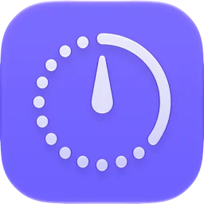
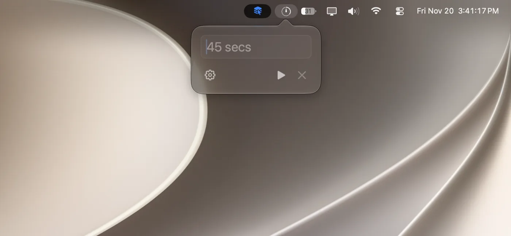
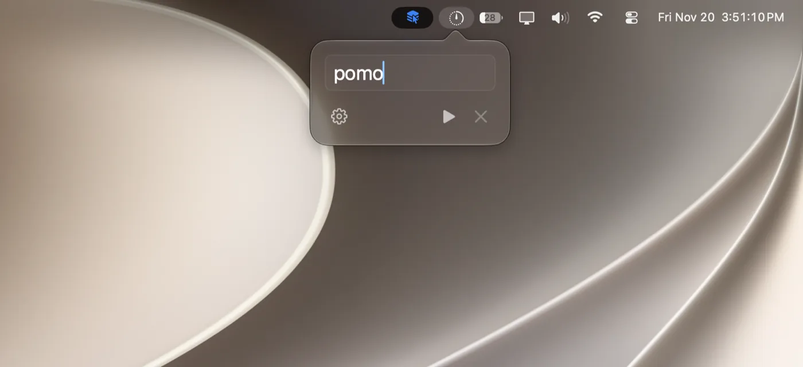
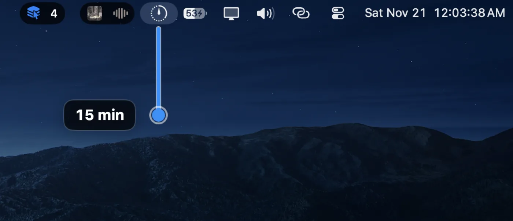
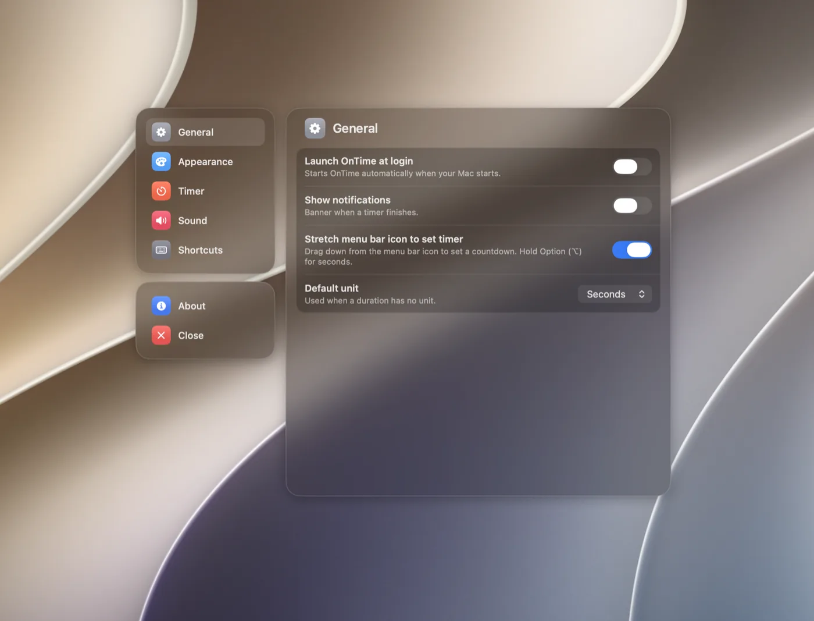

<div align="center">



# OnTime

### Privacy-first menu-bar timer for macOS

Natural-language countdowns, Pomodoro, stopwatch, stretch-to-set, Shortcuts / App Intents, and local session logging — no accounts, no cloud.

</div>

## Screenshots

| Menu bar — countdown | Menu bar — Pomodoro | Stretch to set |
| :---: | :---: | :---: |
|  |  |  |

| Settings |
| :---: |
|  |

## Features

- **Natural language** — `25m`, `1 hour and 39 min`, `10pm`, and relative `+5` / `-2m`
- **Stopwatch & Pomodoro** — configurable cycles, skip phase, +5 minutes
- **Stretch to Set Timer** — drag down from the menu bar icon (⌥ for seconds; Esc cancels)
- **Menu bar styles** — classic, ring, badge, icon-only; fonts including Manrope
- **Display precision** — seconds or tenths for countdown, Pomodoro, and stopwatch
- **Notifications & tones** — actionable alerts, bundled completion sounds, optional custom tone; windup / ticking / ding for focus modes
- **Sleep-overrun guard** — stale timers after wake do not falsely fire
- **`ontime://` URLs** — Shortcuts, Alfred, Raycast, scripts
- **App Intents** — Siri / Shortcuts / Apple Intelligence (macOS 15+), headless
- **Local JSONL log** — no network tracking
- **Sparkle updates** — in-app check for updates (feed goes live with the first public release ZIP)

## Requirements

macOS 14 (Sonoma) or later.

## Installation

### Option 1: Download (when a release is published)

1. Download the latest disk image or ZIP from
   [Releases](https://github.com/RamiruWanigathunga/OnTime/releases/latest).
2. Open the archive and **drag `OnTime.app` into Applications**.
3. Launch OnTime from `/Applications`.

> [!IMPORTANT]
> **Gatekeeper (ad-hoc / non-notarized builds)**
>
> Until releases are notarized with a paid Apple Developer ID, macOS may block
> the first launch after a browser download:
>
> 1. Drag `OnTime.app` to `/Applications` before opening it.
> 2. If you see *“OnTime.app is damaged”* or *“Apple could not verify OnTime”*,
>    clear the quarantine flag, then open again:
>
>    ```bash
>    xattr -cr /Applications/OnTime.app
>    open /Applications/OnTime.app
>    ```
>
> 3. Or right-click the app → **Open** → **Open**, or use **System Settings →
>    Privacy & Security → Open Anyway**.

### Option 2: Build from source

```bash
git clone https://github.com/RamiruWanigathunga/OnTime.git
cd OnTime
open OnTime.xcodeproj
```

Select the **OnTime** scheme and run (Cmd+R), or:

```bash
xcodebuild -project OnTime.xcodeproj -scheme OnTime -destination 'platform=macOS' build
```

See [CONTRIBUTING.md](CONTRIBUTING.md) for tests and project layout. Packaging
details: [RELEASING.md](RELEASING.md).

## URL scheme

| URL | Action |
| --- | --- |
| `ontime://start?duration=25m` | Start countdown |
| `ontime://add?duration=5m` | Add time |
| `ontime://subtract?duration=1m` | Subtract time |
| `ontime://pomodoro` | Start Pomodoro |
| `ontime://stopwatch` | Start stopwatch |
| `ontime://pause` / `ontime://resume` / `ontime://toggle` | Pause controls |
| `ontime://skip` | Skip Pomodoro phase |
| `ontime://stop` / `ontime://clear` | Clear timer |
| `ontime://settings` | Open Settings |

## Siri, Shortcuts, and Apple Intelligence

App Intents require a **real code signature with a Team ID**. Ad-hoc
(“Sign to Run Locally”) builds do not register with Shortcuts/Siri. A free
Apple ID Personal Team is enough for local testing:

1. Xcode → Settings → Accounts → add your Apple ID.
2. OnTime target → Signing & Capabilities → choose your Team.
3. Build & Run once from Xcode.
4. Confirm `codesign -dv …/OnTime.app` shows a non-empty `TeamIdentifier`.
5. Open Shortcuts and search for **OnTime**.

`ontime://` URLs work without Siri registration.

## Session log

Events append to:

`~/Library/Application Support/OnTime/sessions.jsonl`

## Keyboard shortcuts

Configurable in Settings: Open, Pause/resume, Clear, Start Pomodoro, Start stopwatch.

## Tech stack

- **Platform:** macOS 14+
- **Language:** Swift
- **UI:** SwiftUI + AppKit (menu bar / popover)
- **Updates:** [Sparkle](https://sparkle-project.org) 2.x
- **Shortcuts:** [KeyboardShortcuts](https://github.com/sindresorhus/KeyboardShortcuts)

## Privacy

OnTime does not collect or track personal data. Session history stays on your
Mac in Application Support (`sessions.jsonl`).

## Credits

- **OnTime** — Ramiru Wanigathunga
- Upstream **Tock** — [Michael Edelstone](https://github.com/edelstone/tock) (MIT)
- Patterns and timer samples via **TomatoBar** — [Ilya Voronin](https://github.com/ivoronin/TomatoBar) (MIT)
- Focus audio (windup / ticking / ding): [buddhabeats](https://www.buddhabeats.com) timer samples (via TomatoBar)
- Completion tones: [Notification Sounds](https://notificationsounds.com)
- Icons: [Tabler Icons](https://tabler.io/icons)
- Typography: [Manrope](https://fonts.google.com/specimen/Manrope)
- Keyboard shortcuts: [KeyboardShortcuts](https://github.com/sindresorhus/KeyboardShortcuts)
- Auto-updates: [Sparkle](https://sparkle-project.org)
- Stretch-to-set UX inspired by GesTimer / “Stretch It” (no proprietary assets copied)

## Contributing

See [CONTRIBUTING.md](CONTRIBUTING.md) and [CODE_OF_CONDUCT.md](CODE_OF_CONDUCT.md).
Security reports: [SECURITY.md](SECURITY.md).

## License

[PolyForm Shield License 1.0.0](LICENSE) — OnTime’s own code (source-available).

You may use OnTime personally or at work. Providing a product that competes
with OnTime is not permitted. These terms do not expire for a given version.

Upstream Tock and TomatoBar are MIT-licensed; see [LICENSE](LICENSE) for full
terms and third-party notices.
